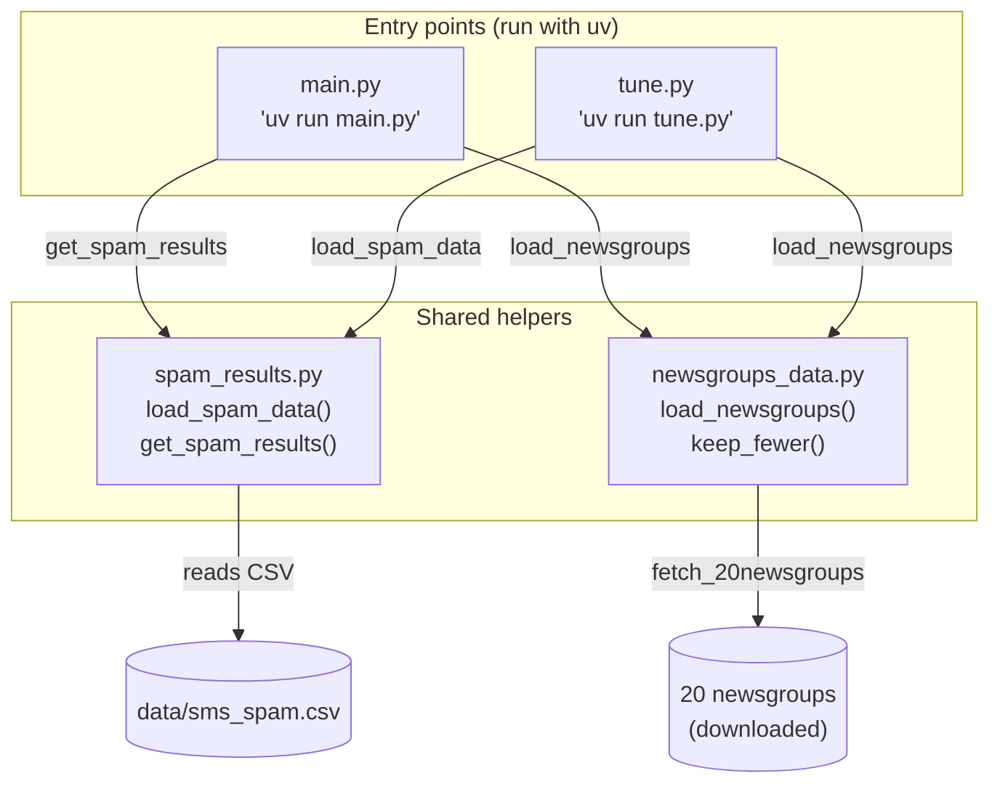
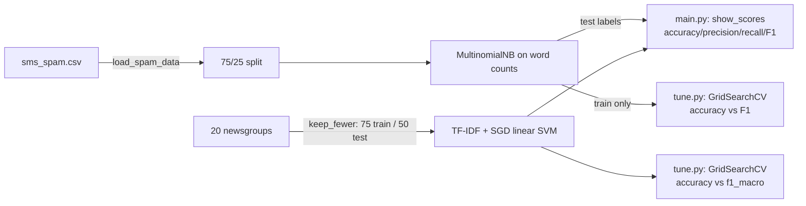

# Program Structure: Classifier Metrics Lab

This document provides a visual overview of the structure and data flow of the Classifier Metrics program.

## Module Structure & Dependencies

## Data Flow

## Summary

- **`spam_results.py`** and **`newsgroups_data.py`** are the reusable helpers — both entry points import from them.
- **`main.py`** shows the *measured* results; **`tune.py`** *tunes* the same two classifiers with `GridSearchCV`, comparing accuracy vs F1.
- The spam classifier is `CountVectorizer → MultinomialNB`; the newsgroups classifier is `CountVectorizer → TfidfTransformer → SGDClassifier` (a linear SVM pipeline).
- `talk.religion.misc` is deliberately kept small (75/50 posts) to create an imbalanced/rare class — the core learning objective of the lab.
