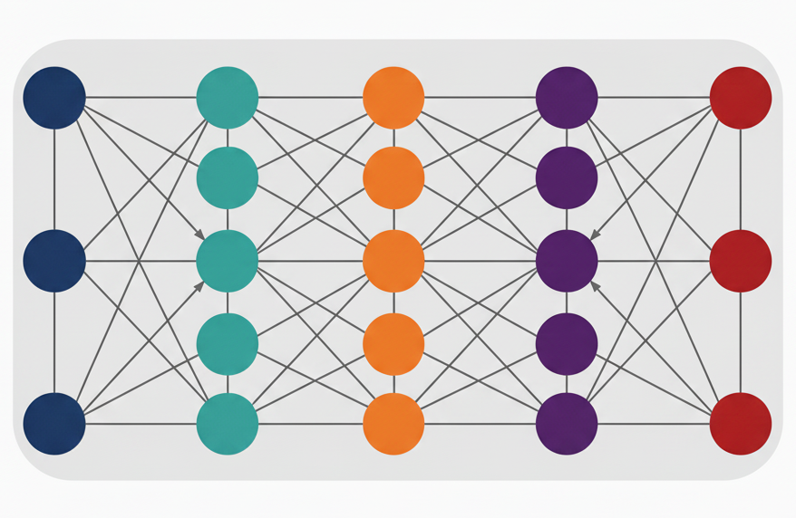

**CS 212, AI Programming 1**

<h1>Week 6 Overview for Fall 2026</h1>

<h2>Nov. 2 through Nov. 8</h2>

| Topics                                  |                                        |
| --------------------------------------- | -------------------------------------- |
| 1. What is AI, Python                   | 6. <mark>ANN: Image recognition</mark> |
| 2. Constraint solvers                   | 7. Generative AI                       |
| 3. Classical machine learning: training | 8. Custom chatbot                      |
| 4.Classical ML: testing and tuning      | 9. LLM fine-tuning                     |
| 5. More ML + History of AI              | 10. Social and ethical issues          |
|                                         | 11. Final project presentation         |

## This Week's Learning Objectives

<figure style="float: right; width: 200px; margin: 0 0 1em 1.5em;">
  
  <figcaption style="text-align: center; font-size: small;">Image by B. Bird using Gemini 2.5</figcaption>
</figure>

By the end of this week you will:

- Know how biological neurons and neural networks function.

- Be able to describe how a perceptron (an artificial neuron) works.

- Be able to explain what an artificial neural network (ANN) is and how it can be used.

- Understand deep learning neural networks.

- Be able to train and use TensorFlow for image recognition.

- Propose your term project.

## Announcements

None yet.

## Things to Do This Week

- Take quiz 5 over ANNs by Sunday, 11/8.
- Lab 4 part 1 due by Sunday, 11/8.
  - Part 1 is a TensorFlow tutorial. See the [Lab 5, Part 1 instructions](../Labs/Lab05-ANN/CS212_Lab04_Part1_Instructions.md).
- Lab 4 part 2 beta version due by Sunday, 11/8.
- Lab 4 part 2 code review due by Tuesday, 11/10.
- Lab 4 part 2 production version due by Thursday, 11/12.

---

 AI Programming 1 Course Materials by <a href="https://profbird.dev" target="_blank">Brian Bird</a>, written in 2025, revised in <time>2026</time>, are licensed under a <a href="http://creativecommons.org/licenses/by-sa/4.0/" target="_blank">Creative Commons Attribution-ShareAlike 4.0 International License</a>. 

---