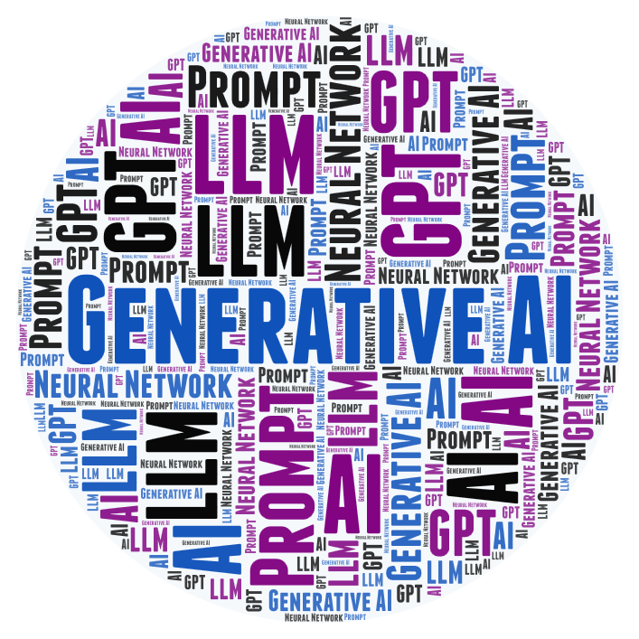

**CS 212, AI Programming 1**

<h1>Week 7 Overview for Fall 2026</h1>

<h2>Nov. 9 through Nov. 15</h2>

| Topics                                  |                                        |
| --------------------------------------- | -------------------------------------- |
| 1. What is AI, Python                   | 6. ANN: Image recognition              |
| 2. Constraint solvers                   | 7. <mark>Generative AI</mark>          |
| 3. Classical machine learning: training | 8. Custom chatbot                      |
| 4.Classical ML: testing and tuning      | 9. LLM fine-tuning                     |
| 5. More ML + History of AI              | 10. Social and ethical issues          |
|                                         | 11. Final project presentation         |

## This Week's Learning Objectives

<figure style="float: right; width: 200px; margin: 0 0 1em 1.5em;">
  
</figure>

By the end of this week you will:

- Be able to explain what generative AI is and how it differs from the AI you have seen so far.

- Understand how large language models (LLMs) are built on neural networks.

- Be able to write effective prompts for AI code generation.

- Understand and use a workflow for AI assisted software development.

## Announcements and Discussion

- **Drop-in Winter Reg Fest**

  Saturday, Nov. 14 and Tuesday, Dec. 1, from 9 am to 2 pm in Building 1, Admissions 102. Help with academic advising, financial aid and billing. If you have prior college experience, verify your transcripts in myLane or bring unofficial copies. See the <a href="https://www.lanecc.edu/community/events/reg-fest" target="_blank">Reg Fest page</a>.

- **Veterans Day**

  The college is closed on Wednesday, Nov. 11.

- Do you have any questions or comments about:
  - Lab 5&mdash;TensorFlow?
  - The reading on Gen AI?
  - Anything else?

## Registration for Winter Term 2027

Registration for winter term is open. If you are pursuing the AAS in Software Development (91&ndash;92 credits, 2026&ndash;27 catalog), these are the recommended winter courses for second-year students, according to the sample term plan:

- CS 275, Introduction to Database Systems and Modeling
- CS 296R, Web Development 2: React (prerequisite: CS 295R)
- CS 246, System Design (prerequisite: CS 295R)
- CS 206, Co-op Ed: CIT Seminar

Courses in the program are offered only in certain terms, so plan ahead. For example, CS 296R and CS 246 are offered only in winter, and CS 297, the capstone, requires both of them. A personal laptop is recommended for second-year students.

### Relevant Links:

- <a href="https://lanecc.smartcatalogiq.com/en/current/lcc-catalog/programs-of-study/computer-information-technology/software-development-aas" target="_blank">Degree Requirements</a> for AAS in Software Dev (2026&ndash;27 catalog)
- <a href="https://docs.google.com/document/d/1PBKakh2utJBAd7Sh2m_A8GzAjCR0Llkdl0QcmD6JxeE/edit?usp=sharing" target="_blank">Term-By-Term Sample Planner</a> for AAS in Software Dev (2026&ndash;27)

- Winter 2027 Class Schedule
- <a href="https://www.lanecc.edu/get-support/academic-support/academic-advising/connect-advising" target="_blank">Academic Advising</a> (or email CitAdvising@lanecc.edu)
- <a href="https://my.lanecc.edu/StudentRegistrationSsb/ssb/registration" target="_blank">Registration</a>

## Things to Do This Week

- Tuesday 11/10
  - Lab 5 part 2 code review.
- Thursday 11/12
  - Lab 5 (TensorFlow), part 2, production version.

### Next Week (Week 8) *Chat Completion API*

**Topic: calling *chat completion* APIs**

- Tuesday 11/17
  - Quiz 6 (GenAI) closes.
  - Lab 6  (AI Coding) beta version.
  - Term project proposal.
- Thursday 11/19
  - Lab 6 code review.
- Sunday 11/22
  - Lab 6, production version.
  - Quiz 7 over calling chat completion APIs.
  - Lab 7 (AI APIs) beta version

## Week 9: *Model Context Protocol* (MCP)

The *Model Context Protocol* (MCP) standardizes communication with and between LLMs to enable  *agentic AI*, allowing an LLM to move beyond simple chat and interact with apps and APIs. It lets developers write applications where AI can do things like  "go look up the user's latest file and then send an email". An MCP server takes care of translating those requests into system actions.

## Week 10:  Your Term Project

Your project can be an entirely new app that incorporates some type of AI, or you can enhance one of your lab projects with an additional or different AI feature than it originally had. The project should be a stand-alone console app (not a Jupyter notebook). 

Submit a project proposal before starting on your app.

---

 AI Programming 1 Course Materials by <a href="https://profbird.dev" target="_blank">Brian Bird</a>, written in 2025, revised in <time>2026</time>, are licensed under a <a href="http://creativecommons.org/licenses/by-sa/4.0/" target="_blank">Creative Commons Attribution-ShareAlike 4.0 International License</a>. 

---
