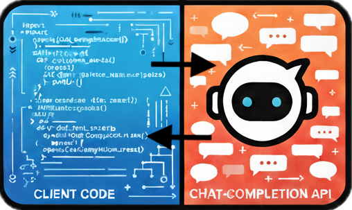

**CS 212, AI Programming 1**

<h1>Week 8 Overview for Fall 2026</h1>

<h2>Nov. 16 through Nov. 22</h2>

| Topics                                  |                                                 |
| --------------------------------------- | ----------------------------------------------- |
| 1. What is AI, Python                   | 6. ANN: Image recognition                       |
| 2. Constraint solvers                   | 7. Generative AI                                |
| 3. Classical machine learning: training | 8. <mark>Calling the chat completion API</mark> |
| 4. Classical ML: testing and tuning     | 9. LLM tool use with MCP                        |
| 5. More ML + History of AI              | 10. Social and ethical issues                   |
|                                         | 11. Final project presentation                  |

## This Week's Learning Objectives

<figure style="float: right; width: 200px; margin: 0 0 1em 1.5em;">
  
  <figcaption style="text-align: center; font-size: small;">Image by B. Bird using Gemini Flash 2.5</figcaption>
</figure>

By the end of this week you will:

- Be able to explain what a chat completion API is and how client code uses it.

- Be able to call a chat completion API from a Python program.

- Be able to build an app that sends prompts to an LLM and uses the responses.

## Announcements and Discussion

- **Register for Winter term**: Registration is open for next term. See the [Registration, Schedules, and the Academic Calendar](https://www.lanecc.edu/programs-academics/registration-schedules-and-academic-calendar) web page for more information and registration links.

- **Drop-in Winter Reg Fest** on Tuesday, Dec. 1 from 9am&ndash;2pm in Building 1, Admissions 102.
  Get help with admissions, financial aid, academic advising and registration.
  Plan to arrive before 1pm.
- **Week 8 is the last week to drop a class or change grade options**
  This <u>Friday, November 20</u> is the last day to make fall term schedule changes. This includes adding or dropping a course, withdrawing or changing grading methods. 
  **Note**: Students should <u>always</u> consult [an academic advisor](https://www.lanecc.edu/get-support/academic-support/academic-advising) and/or [financial aid](https://www.lanecc.edu/costs-admission/paying-college/financial-aid) representative before making these changes, especially withdrawing. These types of changes can potentially have implications for academic progress and/or financial aid awards. 
- Do you have any questions or comments about:
  - Lab 6&mdash;AI-assisted coding?
  - The reading on the chat completion API?
  - Anything else?

## Things to Do This Week

- Tuesday 11/17
  - Lab 6 code review.
- Thursday 11/19
  - Lab 6 production version.
- Sunday 11/22
  - Quiz 7 over calling chat completion APIs.
  - Lab 7 beta version&mdash;share it with your lab partners.

---

 AI Programming 1 Course Materials by <a href="https://profbird.dev" target="_blank">Brian Bird</a>, written in 2025, revised in <time>2026</time>, are licensed under a <a href="http://creativecommons.org/licenses/by-sa/4.0/" target="_blank">Creative Commons Attribution-ShareAlike 4.0 International License</a>. 

---
