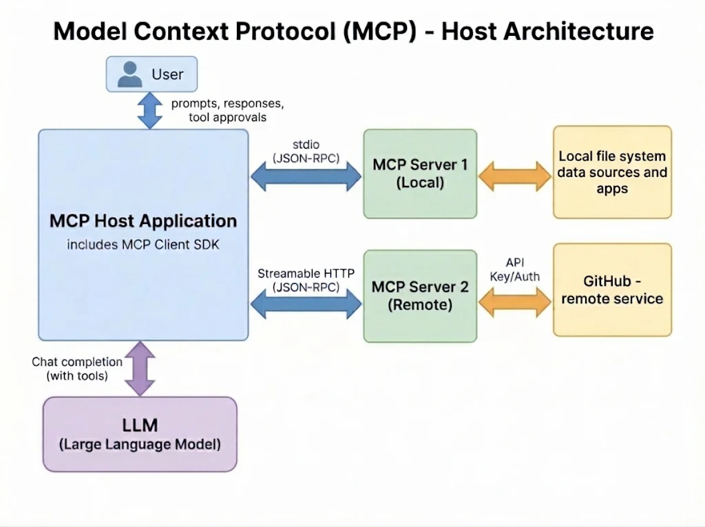

**CS 212, AI Programming 1**

<h1>Model Context Protocol (MCP)</h1>

| Topics                                   |                                                              |
| ---------------------------------------- | ------------------------------------------------------------ |
| 1. What is AI, Python                    | 6. ANN: Image recognition                                    |
| 2.  Symbolic AI                          | 7. Generative AI                                             |
| 3. Classical machine learning: training  | 8. Calling the chat completion API                           |
| 4. Classical machine learning: inference | 9. <mark>Model Context Protocol</mark>                       |
| 5. More ML + History of AI               | 10. Social and ethical issues   Term project completion |
|                                          | 11. Final project presentation                               |

<h2>Contents</h2>

- [Introduction](#introduction)
- [Examples of MCP Hosts](#examples-of-mcp-hosts)
- [Reference](#reference)

## Introduction

An LLM on its own can only produce text. It can't read your files or create an issue on GitHub. The *Model Context Protocol* (MCP) is an open standard, introduced by Anthropic in 2024[^1], that lets AI apps connect an LLM to *tools*: functions provided by other programs and services. The diagram below shows the parts of an MCP system and how they connect.

### The Parts

- **User**: Talks only to the host, typing prompts, reading responses, and approving tool calls. The user never communicates with the LLM directly.
- **MCP Host Application** (blue): An AI app such as Claude Desktop, VS Code, or LM Studio. It runs the conversation and is the only part that talks to both the LLM and the MCP servers. Its built-in MCP client code makes a separate connection to each server.
- **LLM** (purple): Decides what to do. When a *tool* is needed, the LLM doesn't run it directly. Instead, it replies with a *tool call* saying which tool to use and with what arguments. A *tool* is a function that an MCP server makes available for an LLM to use
- **MCP Servers** (green): Programs that provide tools to the host, such as `read_file` or `create_issue`. 
  - **Local server**: runs on your computer, and the host starts it. 
  - **Remote server**: runs on another computer and is reached over the internet.
- **Resources and services** (yellow): What the tools work with: files, databases, or other programs on your computer, or online services such as GitHub.

### The Connections

- **Host ↔ LLM: Chat completion (with tools).** The same kind of API call you made in the chat completion lab, except that the host also sends the list of available tools. This connection is *not* part of MCP.
- **Host ↔ MCP servers: JSON-RPC.** MCP messages are JSON-RPC, a simple standard for sending requests and responses as JSON text. They travel one of two ways:
  - **stdio** (standard input/output) for a local server. The host writes requests to the server program's input and reads its output, much like `input()` and `print()` in Python.
  - **Streamable HTTP** for a remote server. Requests go over the web, like a browser's.
- **MCP servers ↔ resources and services.** Not part of MCP. A local server might read files or run a program. A remote server usually calls the service's web API, using an API key or login to prove it has permission.

### Putting It Together

Suppose you ask an AI app to "Summarize the notes in my *ideas.txt* file."

1. When it starts, the host asks each MCP server which tools it has and gets back a list that includes `read_file`.
2. The host sends your prompt and the tool list to the LLM.
3. The LLM replies with a tool call: use `read_file` with the path `ideas.txt`.
4. The host (usually after asking your permission) sends that request to MCP Server 1, which reads the file and returns its contents.
5. The host sends the file contents back to the LLM, which writes the summary you see.

The LLM never touches your files directly. The host is in charge of every step, which is why MCP apps can ask you to approve each tool call.

## Examples of MCP Hosts

These are freely available applications that incorporate MCP client code so that they can use MCP servers.

- Claude Desktop

- Visual Studio Code

- LM Studio

## Reference

<a href="https://modelcontextprotocol.io/docs/getting-started/intro" target="_blank">What is the Model Context Protocol (MCP)?</a>&mdash;Model Context Protocol Project web site.

<a href="https://lmstudio.ai/docs/app/mcp" target="_blank">Use MCP Servers</a>&mdash;LM Studio documentation.

*Parts of this document were drafted using Gemini 3.0 and revised using Claude Opus 5.5.*

[^1]: The project was started by Anthropic but has since moved to the Linux Foundation

---

 AI Programming 1 lecture notes by <a href="https://profbird.dev" target="_blank">Brian Bird</a>, written in 2025, revised in <time>2026</time>, are licensed under a <a href="http://creativecommons.org/licenses/by-sa/4.0/" target="_blank">Creative Commons Attribution-ShareAlike 4.0 International License</a>. 
