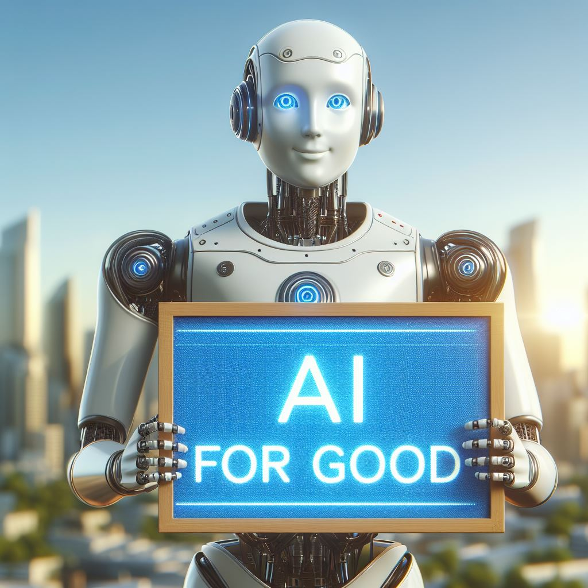

**CS 212, AI Programming 1**

<h1>Week 10 Overview for Fall 2026</h1>

<h2>Nov. 30 through Dec. 6</h2>

| Topics                                  |                                           |
| --------------------------------------- | ----------------------------------------- |
| 1. What is AI, Python                   | 6. ANN: Image recognition                 |
| 2. Constraint solvers                   | 7. Generative AI                          |
| 3. Classical machine learning: training | 8. Calling the chat completion API        |
| 4. Classical ML: testing and tuning     | 9. Agentic AI with MCP                    |
| 5. More ML + History of AI              | 10. <mark>Social and ethical issues</mark> |
|                                         | 11. Final project presentation            |

## This Week's Learning Objectives

<figure style="float: right; width: 200px; margin: 0 0 1em 1.5em;">
  
</figure>

We will discuss the potential (and actual) positive and negative effects of AI on society and the world. You'll also have time in class to work on your lab assignment and term project.

By the end of this week you will:

- Be able to describe some of the positive and negative effects of AI on society.

- Have finished your term project.

## Announcements and Discussion

- **Drop-in Winter Reg Fest** on Tuesday, Dec. 1 from 9am&ndash;2pm in Building 1, Admissions 102.
  Get help with admissions, financial aid, academic advising and registration.
  Plan to arrive before 1pm.
  If you are pursuing the AAS in Software Development, these are the recommended winter courses:
  - If you are in the first year of the program:
    - WR 121Z, Composition 1
    - CS 161N, Computer Science 1: C# (only offered in winter)
    - CS 133JS, Beginning Programming: JavaScript (only offered in winter)
    - A directed elective (see the list in the sample planner)
  - If you are in the second year of the program:
    - CS 275, Basic Database SQL
    - CS 296R, Web Development 2: React (only offered in winter)
    - CS 206, Co-op Ed: CIT Seminar
    - CS 246, System Design (only offered in winter)

  Relevant links:
  - <a href="https://lanecc.smartcatalogiq.com/en/current/lcc-catalog/programs-of-study/computer-information-technology/software-development-aas" target="_blank">Degree Requirements</a> for AAS in Software Dev
  - <a href="https://docs.google.com/document/d/1F8CJY1M7A4J9uJtGRDFRyF-0j7l2AVe0vpPE5vcfHXE/edit?tab=t.0" target="_blank">Term-By-Term Sample Planner</a> for AAS in Software Dev
  - <a href="https://lanecc.edu/advising" target="_blank">Academic Advising</a>
  - [Registration, Schedules, and the Academic Calendar](https://www.lanecc.edu/programs-academics/registration-schedules-and-academic-calendar)

- **Last day for submissions**: Any late assignments are due by the end of the day on **Tuesday, 12/8** (finals week).

- Do you have any questions or comments about:
  - Lab 8&mdash;the MCP tutorial?
  - Your term project?
  - Anything else?

## Things to Do This Week

- Tuesday 12/1
  - Lab 8 code review.
- Thursday 12/3
  - Lab 8 production version.
- Friday 12/4
  - Term project beta version.
- Saturday 12/5
  - Term project code review.

**Next week (finals week):**

- Monday 12/7
  - Term project production version.
- Tuesday 12/8
  - Term project presentations. Read the [Term Project Presentation Guidelines](../Labs/TermProject/CS212-TermProjectPresentationGuide.html).

---

 AI Programming 1 Course Materials by <a href="https://profbird.dev" target="_blank">Brian Bird</a>, written in 2025, revised in <time>2026</time>, are licensed under a <a href="http://creativecommons.org/licenses/by-sa/4.0/" target="_blank">Creative Commons Attribution-ShareAlike 4.0 International License</a>. 

---
